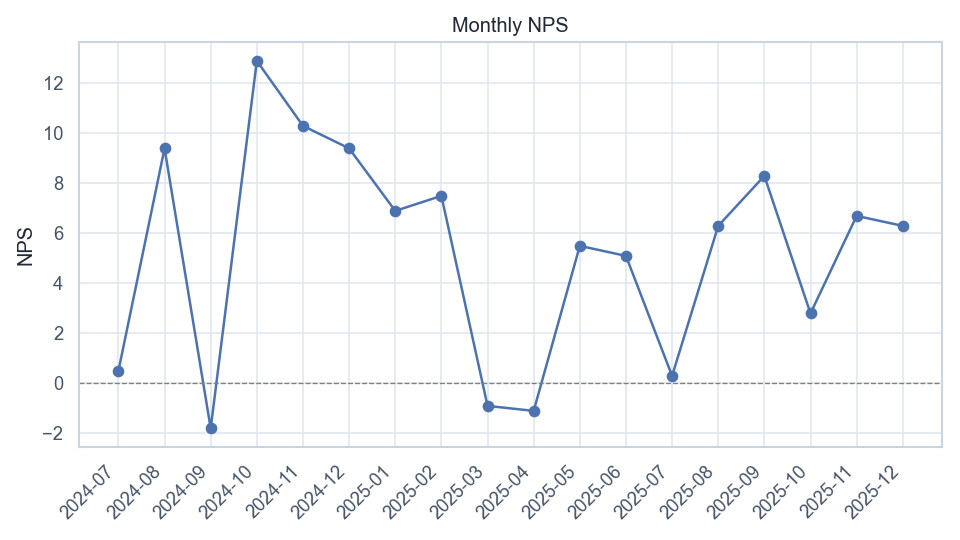

# Volta — NPS Trends

[](https://github.com/NikitaBoyarkin/case-nps/actions/workflows/ci.yml)

[](LICENSE)

Monthly NPS hovers near zero; the strongest drivers are app quality (+30.3) and product (+29.4), the main source of dissatisfaction is fees (−59.4).

## Navigation

- 📖 [Full case study on the portfolio site](https://nikitaboyarkin.github.io/en/projects/volta/nps/)
- 🏦 [Parent project: volta-banking](https://github.com/NikitaBoyarkin/volta-banking)
- 🧪 Related cases: [support-churn](https://github.com/NikitaBoyarkin/case-support-churn) · [churn](https://github.com/NikitaBoyarkin/case-churn)

**On this page:** [Key results](#key-results) · [Situation](#situation) · [Task](#task) · [Actions](#actions) · [Result](#result) · [Recommendations](#recommendations) · [Charts](#charts) · [Dataset](#dataset) · [Quick start](#quick-start)

## Key results

- NPS near zero — customers are neutral
- app_quality +30.3 and product +29.4 — up
- fees −59.4 and onboarding −23.6 — down

## Situation

Are customers promoters or neutrals? And which drivers move NPS.

## Task

I needed to see where customers sit between promoter and neutral, and my job was to find which drivers actually move the score.

## Actions

- Monthly NPS across 18 survey months.
- NPS by driver and promoter mix.

## Result

- NPS hovers near zero: peak **+12.9** (2024-10), bottom **−1.8** (2024-09).
- **app_quality +30.3** and **product +29.4** are the strongest drivers; **fees −59.4** is the main source of dissatisfaction.
- **onboarding −23.6** is consistent with the KYC bottleneck from Project 1.

## Recommendations

- Address the perception of fees (transparency, tariffs) — the biggest negative.
- Clean up onboarding (tie-in with the KYC fix).
- Lean on app quality as a strength in messaging.

## Charts




## Dataset

The dataset is fully synthetic, generated by seeded, reproducible script(s) (`scripts/generate_nps_data.py`). No real customer data is used. Running `make data` regenerates the CSV(s) in `data/` with the same random seed, so every number below is reproducible.

## Quick start

```bash
uv sync --all-groups
make data
make run
```

## Project structure

```text
case-nps/
├── README.md
├── LICENSE
├── .gitignore
├── .python-version
├── pyproject.toml
├── Makefile
├── .github/workflows/ci.yml
├── scripts/
│   ├── generate_nps_data.py
│   └── volta_nps_trends.py
├── utils/
│   ├── __init__.py
│   ├── common.py
│   └── viz_helpers.py
├── data/
│   └── volta_nps_surveys.csv
├── outputs/
│   ├── nps_by_driver.png
│   ├── nps_monthly_trend.png
└── tests/
    └── test_nps.py
```

## Stack

- Python
- pandas / NumPy
- SciPy / Statsmodels
- scikit-learn
- Matplotlib / Seaborn
- uv + ruff

## Links

- [Full case study on the portfolio site](https://nikitaboyarkin.github.io/en/projects/volta/nps/)
- [Parent project — volta-banking](https://github.com/NikitaBoyarkin/volta-banking)
